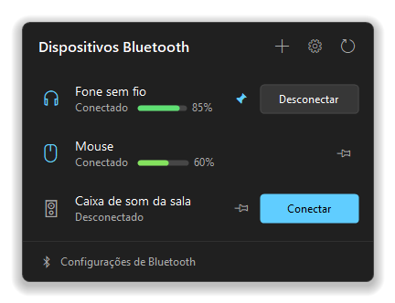

<div align="center">

**English** · [Português](README.pt-BR.md)

# BtTray

**Connect and disconnect your Bluetooth devices with one click, right from the Windows system tray.**




</div>

---

> [!NOTE]
> The BtTray interface starts in **Brazilian Portuguese**. To switch it to English, click the **⚙** gear in the panel and choose **English** under *Idioma* (*Language*). In this document, interface labels are shown in Portuguese followed by the English version, e.g. **Conectar** (*Connect*).

## Contents

- [Why BtTray?](#why-bttray)
- [Features](#features)
- [Requirements](#requirements)
- [Installation](#installation)
- [Usage](#usage)
- [Device compatibility](#device-compatibility)
- [Battery and alerts](#battery-and-alerts)
- [Performance](#performance)
- [Privacy](#privacy)
- [Building from source](#building-from-source)
- [How it works](#how-it-works)
- [Project structure](#project-structure)
- [Troubleshooting](#troubleshooting)
- [Contributing](#contributing)
- [License](#license)

---

## Why BtTray?

On Windows, connecting a headset that is already paired takes several clicks: open Settings, go to *Bluetooth & devices*, find the device and click *Connect*. BtTray cuts that down to **two clicks**: one on the tray icon and one on the device's button.

It is designed to be **small, fast and invisible** while you are not using it.

## Features

- 📋 **Lists all paired devices**, one below the other, with connected ones first.
- ➕ **Finds and pairs new devices** nearby (Bluetooth Classic and LE) without opening Windows Settings.
- 🔌 **Connects and disconnects with one click.** The button shows "Aguarde…" (*Please wait…*) while the operation is in progress.
- 🔋 **Colored battery bar** that shrinks with the charge and changes color: green, yellow/orange and red. Shown when the device reports its battery to Windows.
- 🔔 **Low battery alerts** from Windows at **20%** and **10%**.
- 📌 **Pin a device to the taskbar**: it gets its own tray icon showing the device type (headphones, mouse, keyboard…) and its **battery percentage**, always in view.
- 🖱️ **Lives in the system tray** and works from inside **"Show hidden icons" (^)**.
- 🌗 **Follows the Windows theme**: light or dark, with rounded corners on Windows 11.
- 💬 **Quick tooltip on the icon**: hover to see what is connected and the battery level.
- 🚀 **"Iniciar com o Windows"** (*Start with Windows*) option in the right-click menu.
- 🌐 **Portuguese (Brazil) or English**: pick the language from the ⚙ gear in the panel. Portuguese is the default.
- 🪶 **Ultralight**: a single ~84 KB `.exe`, no installer and no extra dependencies.

## Requirements

| Item | Requirement |
|---|---|
| OS | Windows 10 and Windows 11 (both tested). On Windows 10 the panel has square corners, because rounded corners are a Windows 11 feature. |
| Runtime | .NET Framework 4.8 (already installed on Windows 10 1903+ and Windows 11) |
| Hardware | Bluetooth adapter |
| Permissions | Standard user. Administrator rights are **not** needed for headsets and speakers. |

## Installation

### Option 1: download the executable

1. Go to the [**Releases**](https://github.com/FeOlegario/BtTray/releases) page and download the latest `BtTray.exe`.
2. Put the file in a permanent folder, for example `C:\Programs\BtTray\`.
3. Double-click it to run. The Bluetooth icon appears in the system tray.

> [!NOTE]
> The executable is not digitally signed, so Windows SmartScreen may show a warning the first time you run it. Click **More info → Run anyway**. If you prefer, [build it yourself](#building-from-source) from source.

### Option 2: build from source

See [Building from source](#building-from-source). It takes a few seconds and requires installing nothing.

## Usage

| Action | Result |
|---|---|
| **Left-click** the icon | Opens or closes the device panel |
| **Conectar** / **Desconectar** button (*Connect* / *Disconnect*) | Changes the device connection |
| **📌** pin next to the button | Pins or unpins the device to the taskbar |
| **⟳** icon in the panel or **F5** key | Refreshes the list |
| **+** in the panel | Searches for nearby devices to pair (see below) |
| **⚙** gear in the panel | Opens the BtTray settings (language: Português (Brasil) or English) |
| **Esc** key or click outside | Closes the panel |
| **Right-click** the icon | Menu: Abrir (*Open*), Atualizar (*Refresh*), Iniciar com o Windows (*Start with Windows*), Configurações de Bluetooth (*Bluetooth settings*) and Sair (*Exit*) |
| Hover over the icon | Shows the connected devices and their battery |

**Keep the icon always visible:** by default, Windows may put the icon inside **Show hidden icons (^)**. To keep it on the taskbar, drag it out of that area or turn it on in *Settings → Personalization → Taskbar → Other system tray icons*.

### Adding a new device

1. Put the device in **pairing mode** (usually by holding its power or Bluetooth button until a light blinks).
2. Click **+** at the top of the panel. BtTray lists the nearby devices that are not paired yet; headphones and speakers can take about 30 s to show up. The search runs for 45 s, and **F5** or ⟳ searches again.
3. Click **Emparelhar** (*Pair*) next to the device. If Windows asks you to confirm a PIN, check that it matches the one on the device.
4. Once paired, the device shows up in the main list.

> [!NOTE]
> - While the search runs, headphones that are already connected may stutter for a moment: scanning shares the Bluetooth radio. The search stops on its own when you go back, close the panel or after 45 s.
> - Devices that ask you to **type** a PIN (some older keyboards) are not supported yet. Pair them in *Configurações de Bluetooth* (*Bluetooth settings*).

### Devices pinned to the taskbar

Click the **pin** next to a device's button to pin it. It gets a tray icon of its own:

- At the top, a **drawing of the device type** (headphones, speaker, mouse, keyboard, gamepad…); below it, the **battery percentage**.
- Below 20%, the number takes the battery color (yellow/orange, then red).
- If the device does not report its battery, only the drawing is shown. When disconnected, the drawing is faded.
- Hover to see the name and battery. Click to open the panel. Right-click and choose **Desafixar da barra de tarefas** (*Unpin from taskbar*).
- Pinned devices are remembered when BtTray restarts. The battery is refreshed every 60 s while the panel is closed.

> [!TIP]
> Windows 11 usually puts new icons inside **Show hidden icons (^)**. Drag the device icon onto the taskbar (or turn it on in *Settings → Personalization → Taskbar → Other system tray icons*). Windows remembers this choice for each device, even if you unpin and pin it again.

**Icon indicator:** the icon is **faded** when no device is connected.

**Open the panel from a shortcut:** running `BtTray.exe` again (from the Start menu or a shortcut) does not start a second copy. Instead, it shows the panel of the instance that is already running.

## Device compatibility

| Device type | List | Status | Battery | Connect / Disconnect |
|---|:---:|:---:|:---:|:---:|
| 🎧 Headphones, headsets and speakers (Bluetooth Classic) | ✅ | ✅ | ✅¹ | ✅ |
| ⌨️ Keyboards, mice and others (Bluetooth Classic) | ✅ | ✅ | ⚠️² | ⚠️³ |
| 📡 Bluetooth LE (Low Energy) devices | ✅ | ✅ | ⚠️² | ❌⁴ |

**Legend:** ✅ tested and working · ⚠️ implemented, but untested or with limitations · ❌ not supported

1. The battery is shown when the headset reports it to Windows through the calling profile (Hands-Free), the same value shown in *Settings → Bluetooth & devices*.
2. **Untested.** The app reads the battery from the same property used for headsets, but many keyboards, mice and LE devices report their battery in a different way. In those cases, the percentage is not shown.
3. **Untested.** It works by turning the device's Bluetooth services off and on, and may require **running as administrator**. Read the warning below.
4. Windows does not let apps connect or disconnect LE devices. They connect on their own when they are on and nearby.

> [!WARNING]
> **Keyboards, mice and other non-audio devices:** when you click **Desconectar** (*Disconnect*), BtTray **disables the device's Bluetooth services**. They **stay disabled**, even after restarting the PC, until you click **Conectar** (*Connect*) in BtTray.
>
> If you delete BtTray while a device is in that state, re-enable it through Windows:
> 1. Press `Win + R`, type `control printers` and press Enter.
> 2. Right-click the device and choose **Properties → Services**.
> 3. Check all services and click **OK**.
>
> Alternatively, remove the device and pair it again in *Settings → Bluetooth & devices*.

## Battery and alerts

Every connected device that reports its battery shows a **0% to 100% bar**. The bar shrinks as the charge drops and changes color:

| Charge | Bar color |
|---|---|
| **20% to 100%** | 🟢 Green: deeper near 100% and lighter near 20% |
| **11% to 19%** | 🟡→🟠 From yellow (19%) to orange (11%) |
| **10% or less** | 🔴 Red |

Below 20%, the percentage number also takes the bar color.

<div align="center">

</div>

### Notifications

BtTray warns you through Windows when the battery gets low:

| When | Notification |
|---|---|
| Reaches **20%** | ⚠️ **Bateria fraca** (*Low battery*): "*Device* is at 20% battery. It would be a good idea to charge it." |
| Reaches **10%** | ⛔ **Bateria crítica** (*Critical battery*): "*Device* is down to 10% battery. Charge it now to avoid losing the connection." |

(Notifications follow the language chosen in the settings; the English text is above.)

- Each warning appears **only once** per discharge, even if the reading flips between two values (for example, 20% → 19% → 20%).
- The warnings are re-armed after the device is charged: the 20% one when the battery goes above 25%, and the 10% one when it goes above 15%.
- If BtTray starts with a device already below those levels, the matching warning appears right away.
- With the panel closed, the battery is checked every 60 s, so a warning may take up to about 1 minute to appear.

> [!NOTE]
> Notifications follow the Windows rules. They do not appear if **Do not disturb** is on or if BtTray notifications are turned off in *Settings → System → Notifications*.

## Performance

Measured on Windows 11 with one paired Bluetooth headset:

| Metric | Value |
|---|---|
| Executable size | ~84 KB |
| RAM in use with the panel closed | ~2.3 MB |
| Idle CPU | 0% (0 ms in 15 s) |
| Time to list devices | ~120 ms (in the background) |
| Connect / disconnect a headset | ~0.1 s / ~0.4 s to send the command |

To keep resource use low:
- All device scanning runs **off the UI thread**, so the panel never freezes.
- With the panel closed, the app refreshes only **every 60 s** or when Windows reports that a device changed.
- The interface is drawn by hand instead of using dozens of controls.
- Memory is **released every time the panel closes**.

## Privacy

- ❌ **No internet access**: no telemetry, automatic updates or data sending.
- ❌ **Collects no information** about you or your devices.
- ✅ Writes to only three places on your computer:
  - `HKCU\Software\Microsoft\Windows\CurrentVersion\Run\BtTray`, **only** if you turn on *Iniciar com o Windows* (*Start with Windows*).
  - `%LOCALAPPDATA%\BtTray\servicos-desativados.txt`, **only** when you disconnect a non-audio device, to know which services to re-enable later.
  - `%LOCALAPPDATA%\BtTray\fixados.txt`, **only** if you pin a device to the taskbar (address, type and name of the pinned devices).
  - `%LOCALAPPDATA%\BtTray\configuracoes.txt`, **only** if you change the language (stores just the chosen language).

## Building from source

No Visual Studio or SDK needed: the project uses the C# compiler that ships with .NET Framework 4.8 on Windows.

```powershell
git clone https://github.com/FeOlegario/BtTray.git
cd BtTray
powershell -ExecutionPolicy Bypass -File build.ps1
```

The executable is created at `bin\BtTray.exe`.

> [!TIP]
> The script also creates the application icon (`app.ico`) if it does not exist.

> [!NOTE]
> The device search uses WinRT (`Windows.Devices.Enumeration`). The references to its metadata, which ships with Windows 10/11, are in `winrt.rsp` and passed to the compiler as `@winrt.rsp`. The paths in it assume Windows is installed in `C:\Windows`.

### Diagnostic tool (optional)

The `test/` folder has a command-line utility that lists the devices and tests the actions without opening the interface:

```powershell
New-Item -ItemType Directory -Force bin | Out-Null
$csc = "$env:WINDIR\Microsoft.NET\Framework64\v4.0.30319\csc.exe"
& $csc /nologo /out:bin\bttest.exe src\Bluetooth.cs src\Lang.cs test\TestMain.cs

.\bin\bttest.exe                 # lists the devices
.\bin\bttest.exe disconnect 0    # disconnects the device at index 0
.\bin\bttest.exe connect 0       # connects the device at index 0
```

### Interface and alert preview (optional)

`test/PreviewMain.cs` renders images of the panel with fake devices at several battery levels, in the light and dark themes. It also checks the alert rules with simulated readings and can show the two real notifications:

```powershell
New-Item -ItemType Directory -Force bin | Out-Null
$csc = "$env:WINDIR\Microsoft.NET\Framework64\v4.0.30319\csc.exe"
& $csc /nologo /main:BtTray.PreviewMain /out:bin\preview.exe /win32manifest:app.manifest `
    '@winrt.rsp' /r:System.Windows.Forms.dll /r:System.Drawing.dll src\*.cs test\PreviewMain.cs

.\bin\preview.exe bin\preview.png                # creates preview-claro.png, preview-escuro.png and preview-icones.png
.\bin\preview.exe bin\preview.png --notificar    # also shows the 20% and 10% notifications
```

### Automated alert tests

`test/AlertTests.cs` checks the battery warning rules (20%, 10%, flickering and re-arming) without UI or Bluetooth. It exits with an error if any rule fails:

```powershell
New-Item -ItemType Directory -Force bin | Out-Null
$csc = "$env:WINDIR\Microsoft.NET\Framework64\v4.0.30319\csc.exe"
& $csc /nologo /main:BtTray.AlertTests /out:bin\alerttests.exe `
    '@winrt.rsp' /r:System.Windows.Forms.dll /r:System.Drawing.dll src\*.cs test\AlertTests.cs
.\bin\alerttests.exe
```

### Continuous integration

On every push (to any branch) and pull request, the `.github/workflows/build.yml` workflow runs `build.ps1` on Windows, runs the alert tests, builds the `test/` tools and uploads the panel preview images as a run artifact. The `BtTray.exe` of each run and the Releases are handled by `release.yml`, described below.

### Publishing a new version

The `.github/workflows/release.yml` workflow builds the project on a Windows runner on every pull request and push to `main`. To publish a version:

1. Update `AssemblyVersion` and `AssemblyFileVersion` in `src/Program.cs` (e.g. `1.1.0.0`).
2. Create and push the matching tag:

   ```powershell
   git tag v1.1.0
   git push origin v1.1.0
   ```

The workflow checks that the tag matches the `.exe` version, builds it and creates the Release with `BtTray.exe` and the `BtTray.exe.sha256` file.

**Release notes:** before tagging, create `release-notes/vX.Y.Z.md` (named after the tag) describing what changed, in English and in Portuguese. Use the existing files as a template. The workflow uses that file as the Release text. If it does not exist, the notes show the list of commits since the previous tag. Either way, when changes come in through pull requests, GitHub adds a **What's Changed** section listing them.

## How it works

| Function | Technique |
|---|---|
| List devices | `SetupAPI` (enumerators `BTHENUM`, `BTHLE`, `BTHLEDEVICE` and `BTHHFENUM`) |
| Connection status | Device property `{83DA6326-…} 15` (connected) |
| Battery | Property `{104EA319-…} 2`, the same one used by Windows Settings |
| Find and pair new devices | WinRT `Windows.Devices.Enumeration` (`DeviceWatcher` and `DeviceInformationCustomPairing`), the same API used by Windows Settings |
| Pinned devices | One icon per device with `Shell_NotifyIcon` and a stable GUID derived from its address, so Windows remembers whether it stays visible |
| Battery alerts | Tray notifications (`NotifyIcon.ShowBalloonTip`), which Windows 10/11 shows as system notifications |
| Connect / disconnect audio | `IOCTL_KS_PROPERTY` with `KSPROPSETID_BtAudio` (`ONESHOT_RECONNECT` / `ONESHOT_DISCONNECT`), the same mechanism as the Windows "Connect" button. To disconnect, the whole link is then dropped with `IOCTL_BTH_DISCONNECT_DEVICE`, since many headsets also keep a HID link for their buttons |
| Connect / disconnect others | `BluetoothSetServiceState` (`bthprops.cpl`) |
| Interface | Owner-drawn WinForms (GDI/GDI+), icons from the *Segoe Fluent Icons* or *Segoe MDL2 Assets* font |
| Detect changes | `WM_DEVICECHANGE` message, with a short delay before refreshing |

## Project structure

```
BtTray/
├── src/
│   ├── Program.cs       # Entry point, tray icon, menu, refreshes and start with Windows
│   ├── PopupForm.cs     # Owner-drawn panel (flyout), including the settings view
│   ├── Lang.cs          # Interface language (pt-BR or English) and where it is saved
│   ├── Bluetooth.cs     # Enumeration, battery, connect/disconnect (P/Invoke)
│   ├── BatteryAlerts.cs # Low (20%) and critical (10%) battery warning rules
│   ├── PinnedIcons.cs   # Icons of the devices pinned to the taskbar and their saved list
│   ├── Discovery.cs     # Search for nearby unpaired devices and pairing (WinRT)
│   └── Theme.cs         # Light/dark colors, battery bar colors, glyphs and tray icons
├── test/
│   ├── TestMain.cs      # Command-line diagnostic tool
│   ├── PreviewMain.cs   # Panel preview and alert check
│   └── AlertTests.cs    # Automated alert rule tests (run in CI)
├── .github/workflows/
│   ├── build.yml        # CI: builds and tests on every push and PR
│   └── release.yml      # Builds and publishes Releases when a tag is pushed
├── docs/
│   ├── screenshot.png
│   └── cores-bateria.png
├── release-notes/       # Notes for each version (vX.Y.Z.md), in English and Portuguese
├── app.manifest         # DPI, Windows 10/11 compatibility, runs without administrator
├── app.ico              # Executable icon
├── build.ps1            # Build script
├── winrt.rsp            # Compiler references for WinRT (device search)
├── README.md            # This document
├── README.pt-BR.md      # This document in Portuguese
└── LICENSE              # MIT License
```

## Troubleshooting

<details>
<summary><b>The icon does not appear in the tray</b></summary>

Check inside **Show hidden icons (^)**. Windows usually puts new icons there. Drag it onto the taskbar to keep it visible.
</details>

<details>
<summary><b>My device is not in the list</b></summary>

The main list only shows **already paired** devices. To pair a new one, click **+** in the panel (see [Adding a new device](#adding-a-new-device)). If it does not show up in the search, check that it is in pairing mode and not connected to another device, such as your phone.
</details>

<details>
<summary><b>"Não conectou. Ele está ligado e por perto?" (<i>Did not connect. Is it on and nearby?</i>)</b></summary>

The command was sent, but the device did not respond within 20 seconds. Check that it is on, nearby and out of its case (for earbuds), and that it is not connected to another device, such as your phone.
</details>

<details>
<summary><b>The battery is not shown</b></summary>

Not every device reports its battery to Windows. If it does not appear in *Settings → Bluetooth & devices*, it will not appear in BtTray either. The battery is only shown while the device is connected.
</details>

<details>
<summary><b>I did not get the low battery warning</b></summary>

Check that **Do not disturb** is off and that BtTray notifications are enabled in *Settings → System → Notifications*. Also remember that each warning appears only once per discharge and that, with the panel closed, the battery is checked every 60 s.
</details>

<details>
<summary><b>It asks for administrator rights for a keyboard or mouse</b></summary>

For non-audio devices, Windows requires elevated privileges to change Bluetooth services. Right-click `BtTray.exe` and choose **Run as administrator**.
</details>

## Contributing

Contributions are welcome!

1. **Fork** the repository.
2. Create a branch: `git checkout -b my-improvement`.
3. Build with `build.ps1` and test with your devices.
4. Open a **Pull Request** describing the change and the devices you tested with.

Found a bug or have a device that does not work? Open an [**Issue**](https://github.com/FeOlegario/BtTray/issues) with the device model, the Windows version and what happened.

## License

Distributed under the **MIT License**. You can use, copy, modify and distribute this software freely, including for commercial purposes, as long as you keep the copyright notice. See the [LICENSE](LICENSE) file for the full text.
