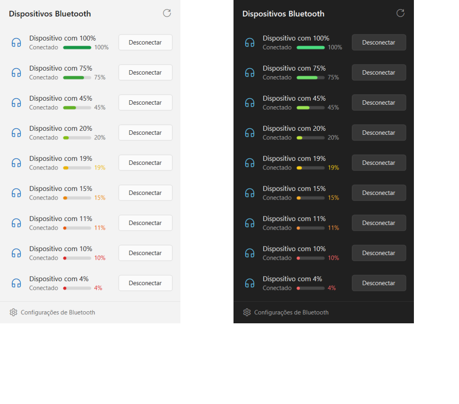

<div align="center">

# BtTray

**Conecte e desconecte seus dispositivos Bluetooth com um clique, direto da bandeja do Windows.**


</div>

---

## Sumário

- [Por que o BtTray?](#por-que-o-bttray)
- [Recursos](#recursos)
- [Requisitos](#requisitos)
- [Instalação](#instalação)
- [Como usar](#como-usar)
- [Compatibilidade de dispositivos](#compatibilidade-de-dispositivos)
- [Bateria e alertas](#bateria-e-alertas)
- [Desempenho](#desempenho)
- [Privacidade](#privacidade)
- [Compilando a partir do código](#compilando-a-partir-do-código)
- [Como funciona](#como-funciona)
- [Estrutura do projeto](#estrutura-do-projeto)
- [Solução de problemas](#solução-de-problemas)
- [Contribuindo](#contribuindo)
- [Licença](#licença)

---

## Por que o BtTray?

No Windows, conectar um fone que já está emparelhado exige vários cliques: abrir as Configurações, entrar em *Bluetooth e dispositivos*, localizar o aparelho e clicar em *Conectar*. O BtTray reduz isso a **dois cliques**: um no ícone da bandeja e outro no botão do dispositivo.

Ele foi feito para ser **pequeno, rápido e invisível** enquanto não está em uso.

## Recursos

- 📋 **Lista todos os dispositivos emparelhados**, um embaixo do outro, com os conectados primeiro.
- 🔌 **Conecta e desconecta com um clique.** O botão mostra "Aguarde…" enquanto a operação acontece.
- 🔋 **Barra de bateria colorida** que diminui com a carga e muda de cor: verde, amarelo/laranja e vermelho. Aparece quando o dispositivo informa a bateria ao Windows.
- 🔔 **Alertas de bateria fraca** no Windows aos **20%** e aos **10%**.
- 🖱️ **Vive na bandeja do sistema** e funciona dentro de **"Mostrar ícones ocultos" (^)**.
- 🌗 **Segue o tema do Windows**: claro ou escuro, com cantos arredondados.
- 💬 **Dica rápida no ícone**: passe o mouse para ver o que está conectado e a bateria.
- 🚀 **Opção "Iniciar com o Windows"** no menu do botão direito.
- 🪶 **Ultraleve**: um único `.exe` de ~48 KB, sem instalador e sem dependências extras.

## Requisitos

| Item | Requisito |
|---|---|
| Sistema | Windows 11 (testado). O Windows 10 deve funcionar, sem os cantos arredondados, mas ainda não foi testado. |
| Runtime | .NET Framework 4.8 (já vem instalado no Windows 10 1903+ e no Windows 11) |
| Hardware | Adaptador Bluetooth |
| Permissões | Usuário comum. Administrador **não** é necessário para fones e caixas de som. |

## Instalação

### Opção 1: baixar o executável

1. Acesse a página de [**Releases**](https://github.com/FeOlegario/BtTray/releases) e baixe o `BtTray.exe` mais recente.
2. Coloque o arquivo em uma pasta permanente, por exemplo `C:\Programas\BtTray\`.
3. Dê dois cliques para executar. O ícone de Bluetooth aparece na bandeja.

> [!NOTE]
> O executável não é assinado digitalmente. Por isso, o Windows SmartScreen pode exibir um aviso na primeira execução. Clique em **Mais informações → Executar assim mesmo**. Se preferir, [compile você mesmo](#compilando-a-partir-do-código) a partir do código.

### Opção 2: compilar do código

Veja [Compilando a partir do código](#compilando-a-partir-do-código). Leva poucos segundos e não exige instalar nada.

## Como usar

| Ação | Resultado |
|---|---|
| **Clique esquerdo** no ícone | Abre ou fecha o painel de dispositivos |
| Botão **Conectar** / **Desconectar** | Altera a conexão do dispositivo |
| Ícone **⟳** no painel ou tecla **F5** | Atualiza a lista |
| Tecla **Esc** ou clique fora | Fecha o painel |
| **Clique direito** no ícone | Menu: Abrir, Atualizar, Iniciar com o Windows, Configurações de Bluetooth e Sair |
| Passar o mouse sobre o ícone | Mostra os dispositivos conectados e a bateria |

**Deixar o ícone sempre visível:** por padrão, o Windows pode colocar o ícone dentro de **Mostrar ícones ocultos (^)**. Para fixá-lo na barra de tarefas, arraste o ícone para fora dessa área ou ative-o em *Configurações → Personalização → Barra de tarefas → Outros ícones da bandeja do sistema*.

**Indicador do ícone:** o ícone fica **mais apagado** quando nenhum dispositivo está conectado.

**Abrir o painel por um atalho:** executar o `BtTray.exe` de novo (pelo menu Iniciar ou por um atalho) não abre uma segunda cópia. Em vez disso, mostra o painel da instância que já está rodando.

## Compatibilidade de dispositivos

| Tipo de dispositivo | Listar | Status | Bateria | Conectar / Desconectar |
|---|:---:|:---:|:---:|:---:|
| 🎧 Fones, headsets e caixas de som (Bluetooth clássico) | ✅ | ✅ | ✅¹ | ✅ |
| ⌨️ Teclados, mouses e outros (Bluetooth clássico) | ✅ | ✅ | ⚠️² | ⚠️³ |
| 📡 Dispositivos Bluetooth LE (Low Energy) | ✅ | ✅ | ⚠️² | ❌⁴ |

**Legenda:** ✅ testado e funcionando · ⚠️ implementado, mas não testado ou com limitações · ❌ não suportado

1. A bateria aparece quando o fone a informa ao Windows pelo perfil de chamadas (Hands-Free), o mesmo dado mostrado em *Configurações → Bluetooth e dispositivos*.
2. **Não testado.** O app lê a bateria pela mesma propriedade usada para os fones, mas muitos teclados, mouses e dispositivos LE informam a bateria de outro jeito. Nesses casos, a porcentagem não aparece.
3. **Não testado.** Funciona ligando e desligando os serviços Bluetooth do dispositivo e pode exigir **executar como administrador**. Leia o aviso abaixo.
4. O Windows não permite que aplicativos conectem ou desconectem dispositivos LE. Eles se conectam sozinhos quando estão ligados e por perto.

> [!WARNING]
> **Teclados, mouses e outros dispositivos que não são de áudio:** ao clicar em **Desconectar**, o BtTray **desativa os serviços Bluetooth** do dispositivo. Eles **continuam desativados**, mesmo depois de reiniciar o PC, até você clicar em **Conectar** no BtTray.
>
> Se você apagar o BtTray com algum dispositivo nesse estado, reative-o pelo Windows:
> 1. Pressione `Win + R`, digite `control printers` e pressione Enter.
> 2. Clique com o botão direito no dispositivo e escolha **Propriedades → Serviços**.
> 3. Marque todos os serviços e clique em **OK**.
>
> Outra opção é remover o dispositivo e emparelhá-lo de novo em *Configurações → Bluetooth e dispositivos*.

## Bateria e alertas

Cada dispositivo conectado que informa a bateria mostra uma **barra de 0% a 100%**. A barra diminui conforme a carga cai e muda de cor:

| Carga | Cor da barra |
|---|---|
| **20% a 100%** | 🟢 Verde: mais forte perto de 100% e mais claro perto de 20% |
| **11% a 19%** | 🟡→🟠 Do amarelo (19%) ao laranja (11%) |
| **10% ou menos** | 🔴 Vermelho |

Abaixo de 20%, o número da porcentagem também ganha a cor da barra.

<div align="center">

</div>

### Notificações

O BtTray avisa pelo Windows quando a bateria fica baixa:

| Quando | Notificação |
|---|---|
| Chega a **20%** | ⚠️ **Bateria fraca:** "*Dispositivo* está com 20% de bateria. Seria bom carregar o dispositivo." |
| Chega a **10%** | ⛔ **Bateria crítica:** "*Dispositivo* está com apenas 10% de bateria. Carregue agora para não perder a conexão." |

- Cada aviso aparece **uma única vez** por descarga, mesmo que a leitura oscile entre dois valores (por exemplo, 20% → 19% → 20%).
- Os avisos voltam a valer depois que o dispositivo é carregado: o de 20% quando a bateria passa de 25%, e o de 10% quando passa de 15%.
- Se o BtTray for aberto com um dispositivo já abaixo desses níveis, o aviso correspondente aparece logo.
- Com o painel fechado, a bateria é verificada a cada 60 s, então o aviso pode levar até cerca de 1 minuto para aparecer.

> [!NOTE]
> As notificações seguem as regras do Windows. Elas não aparecem se o modo **Não incomodar** estiver ativo ou se as notificações do BtTray estiverem desligadas em *Configurações → Sistema → Notificações*.

## Desempenho

Medições em um Windows 11 com um fone Bluetooth emparelhado:

| Métrica | Valor |
|---|---|
| Tamanho do executável | ~48 KB |
| RAM em uso com o painel fechado | ~2,3 MB |
| CPU ocioso | 0% (0 ms em 15 s) |
| Tempo para listar os dispositivos | ~120 ms (em segundo plano) |
| Conectar / desconectar um fone | ~0,1 s / ~0,4 s para enviar o comando |

Para manter o consumo baixo:
- Toda a busca de dispositivos roda **fora da thread da interface**, para que o painel nunca trave.
- Com o painel fechado, o app atualiza só **a cada 60 s** ou quando o Windows avisa que algum dispositivo mudou.
- A interface é desenhada manualmente, em vez de usar dezenas de controles.
- A memória é **liberada sempre que o painel fecha**.

## Privacidade

- ❌ **Não acessa a internet**: não há telemetria, atualizações automáticas ou envio de dados.
- ❌ **Não coleta informações** sobre você ou seus dispositivos.
- ✅ Só grava em dois lugares no seu computador:
  - `HKCU\Software\Microsoft\Windows\CurrentVersion\Run\BtTray`, **somente** se você ativar *Iniciar com o Windows*.
  - `%LOCALAPPDATA%\BtTray\servicos-desativados.txt`, **somente** ao desconectar um dispositivo não-áudio, para saber quais serviços reativar depois.

## Compilando a partir do código

Não é preciso Visual Studio nem SDK: o projeto usa o compilador C# que já acompanha o .NET Framework 4.8 no Windows.

```powershell
git clone https://github.com/FeOlegario/BtTray.git
cd BtTray
powershell -ExecutionPolicy Bypass -File build.ps1
```

O executável é gerado em `bin\BtTray.exe`.

> [!TIP]
> O script também cria o ícone do aplicativo (`app.ico`) se ele não existir.

### Ferramenta de diagnóstico (opcional)

A pasta `test/` tem um utilitário de linha de comando que lista os dispositivos e testa as ações sem abrir a interface:

```powershell
New-Item -ItemType Directory -Force bin | Out-Null
$csc = "$env:WINDIR\Microsoft.NET\Framework64\v4.0.30319\csc.exe"
& $csc /nologo /out:bin\bttest.exe src\Bluetooth.cs test\TestMain.cs

.\bin\bttest.exe                 # lista os dispositivos
.\bin\bttest.exe disconnect 0    # desconecta o dispositivo de índice 0
.\bin\bttest.exe connect 0       # conecta o dispositivo de índice 0
```

### Prévia da interface e dos alertas (opcional)

O `test/PreviewMain.cs` gera imagens do painel com dispositivos fictícios em vários níveis de bateria, nos temas claro e escuro. Ele também confere as regras dos alertas com leituras simuladas e pode exibir as duas notificações reais:

```powershell
New-Item -ItemType Directory -Force bin | Out-Null
$csc = "$env:WINDIR\Microsoft.NET\Framework64\v4.0.30319\csc.exe"
& $csc /nologo /main:BtTray.PreviewMain /out:bin\preview.exe /win32manifest:app.manifest `
    /r:System.Windows.Forms.dll /r:System.Drawing.dll src\*.cs test\PreviewMain.cs

.\bin\preview.exe bin\preview.png                # gera preview-claro.png e preview-escuro.png
.\bin\preview.exe bin\preview.png --notificar    # também mostra as notificações de 20% e 10%
```

### Testes automáticos dos alertas

O `test/AlertTests.cs` confere as regras dos avisos de bateria (20%, 10%, oscilação e rearme) sem interface e sem Bluetooth. Ele termina com erro se alguma regra falhar:

```powershell
New-Item -ItemType Directory -Force bin | Out-Null
$csc = "$env:WINDIR\Microsoft.NET\Framework64\v4.0.30319\csc.exe"
& $csc /nologo /main:BtTray.AlertTests /out:bin\alerttests.exe `
    /r:System.Windows.Forms.dll /r:System.Drawing.dll src\*.cs test\AlertTests.cs
.\bin\alerttests.exe
```

### Integração contínua

A cada push (em qualquer branch) e pull request, o workflow `.github/workflows/build.yml` roda o `build.ps1` no Windows, executa os testes dos alertas, compila as ferramentas de `test/` e publica as imagens de prévia do painel como artefato da execução. O `BtTray.exe` de cada execução e as Releases ficam com o `release.yml`, descrito abaixo.

### Publicando uma nova versão

O workflow `.github/workflows/release.yml` compila o projeto num runner Windows a cada pull request e push na `main`. Para publicar uma versão:

1. Atualize `AssemblyVersion` e `AssemblyFileVersion` em `src/Program.cs` (ex.: `1.1.0.0`).
2. Crie e envie a tag correspondente:

   ```powershell
   git tag v1.1.0
   git push origin v1.1.0
   ```

O workflow confere se a tag bate com a versão do `.exe`, compila e cria a Release com o `BtTray.exe` e o arquivo `BtTray.exe.sha256`.

## Como funciona

| Função | Técnica |
|---|---|
| Listar dispositivos | `SetupAPI` (enumeradores `BTHENUM`, `BTHLE`, `BTHLEDEVICE` e `BTHHFENUM`) |
| Status de conexão | Propriedade de dispositivo `{83DA6326-…} 15` (conectado) |
| Bateria | Propriedade `{104EA319-…} 2`, a mesma usada pelas Configurações do Windows |
| Alertas de bateria | Notificações da bandeja (`NotifyIcon.ShowBalloonTip`), que o Windows 10/11 exibe como notificações do sistema |
| Conectar / desconectar áudio | `IOCTL_KS_PROPERTY` com `KSPROPSETID_BtAudio` (`ONESHOT_RECONNECT` / `ONESHOT_DISCONNECT`), o mesmo mecanismo do botão "Conectar" do Windows |
| Conectar / desconectar outros | `BluetoothSetServiceState` (`bthprops.cpl`) |
| Interface | WinForms com desenho próprio (GDI/GDI+), ícones da fonte *Segoe Fluent Icons* ou *Segoe MDL2 Assets* |
| Detectar mudanças | Mensagem `WM_DEVICECHANGE`, com intervalo de espera antes de atualizar |

## Estrutura do projeto

```
BtTray/
├── src/
│   ├── Program.cs       # Ponto de entrada, ícone da bandeja, menu, atualizações e inicialização com o Windows
│   ├── PopupForm.cs     # Painel (flyout) desenhado manualmente
│   ├── Bluetooth.cs     # Enumeração, bateria, conectar/desconectar (P/Invoke)
│   ├── BatteryAlerts.cs # Regras dos avisos de bateria fraca (20%) e crítica (10%)
│   └── Theme.cs         # Cores claro/escuro, cores da barra de bateria, glifos e ícone da bandeja
├── test/
│   ├── TestMain.cs      # Ferramenta de diagnóstico em linha de comando
│   ├── PreviewMain.cs   # Prévia do painel e teste dos alertas
│   └── AlertTests.cs    # Testes automáticos das regras de alerta (rodam no CI)
├── .github/workflows/
│   ├── build.yml        # CI: compila e testa a cada push e PR
│   └── release.yml      # Compila e publica Releases ao enviar tag
├── docs/
│   ├── screenshot.png
│   └── cores-bateria.png
├── app.manifest         # DPI, compatibilidade com Windows 10/11, execução sem administrador
├── app.ico              # Ícone do executável
├── build.ps1            # Script de compilação
└── LICENSE              # Licença MIT
```

## Solução de problemas

<details>
<summary><b>O ícone não aparece na bandeja</b></summary>

Verifique em **Mostrar ícones ocultos (^)**. O Windows costuma colocar ícones novos ali. Arraste-o para a barra de tarefas para mantê-lo visível.
</details>

<details>
<summary><b>Meu dispositivo não aparece na lista</b></summary>

O BtTray mostra apenas dispositivos **já emparelhados**. Para emparelhar um novo, use *Configurações de Bluetooth* no próprio painel e depois clique em ⟳.
</details>

<details>
<summary><b>"Não conectou. Ele está ligado e por perto?"</b></summary>

O comando foi enviado, mas o dispositivo não respondeu em até 20 segundos. Confira se ele está ligado, por perto e fora do estojo (no caso de fones), e se não está conectado a outro aparelho, como o celular.
</details>

<details>
<summary><b>A bateria não aparece</b></summary>

Nem todo dispositivo informa a bateria ao Windows. Se ela não aparecer em *Configurações → Bluetooth e dispositivos*, também não vai aparecer no BtTray. A bateria só é exibida enquanto o dispositivo está conectado.
</details>

<details>
<summary><b>Não recebi o aviso de bateria fraca</b></summary>

Confira se o modo **Não incomodar** está desligado e se as notificações do BtTray estão ativas em *Configurações → Sistema → Notificações*. Lembre também que cada aviso aparece só uma vez por descarga e que, com o painel fechado, a bateria é verificada a cada 60 s.
</details>

<details>
<summary><b>Pede permissão de administrador para teclado ou mouse</b></summary>

Para dispositivos que não são de áudio, o Windows exige privilégios elevados para alterar os serviços Bluetooth. Clique com o botão direito no `BtTray.exe` e escolha **Executar como administrador**.
</details>

## Contribuindo

Contribuições são bem-vindas!

1. Faça um **fork** do repositório.
2. Crie uma branch: `git checkout -b minha-melhoria`.
3. Compile com `build.ps1` e teste com seus dispositivos.
4. Abra um **Pull Request** descrevendo a mudança e os dispositivos com que testou.

Encontrou um bug ou tem um dispositivo que não funciona? Abra uma [**Issue**](https://github.com/FeOlegario/BtTray/issues) informando o modelo do dispositivo, a versão do Windows e o que aconteceu.

## Licença

Distribuído sob a **licença MIT**. Você pode usar, copiar, modificar e distribuir este software livremente, inclusive para fins comerciais, desde que mantenha o aviso de copyright. Veja o arquivo [LICENSE](LICENSE) para o texto completo.
